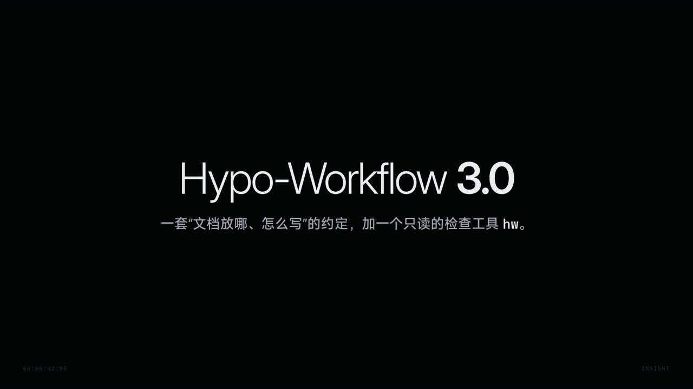
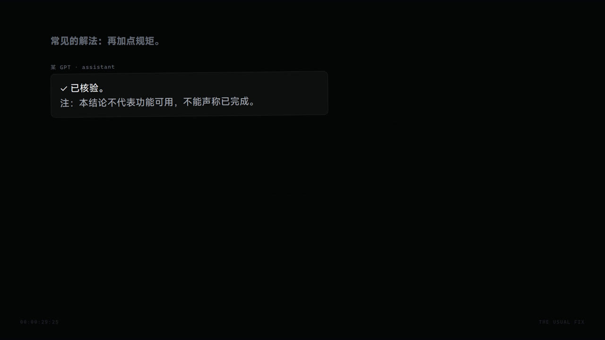
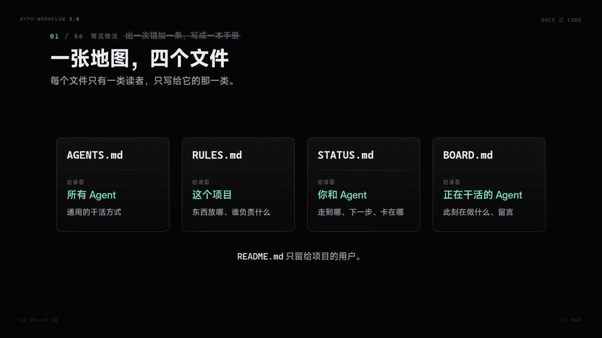
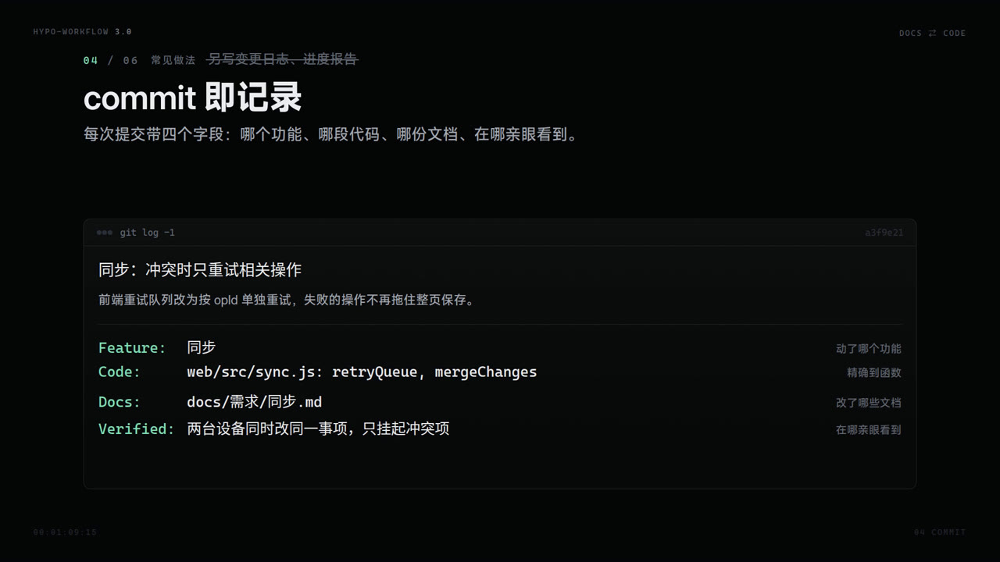
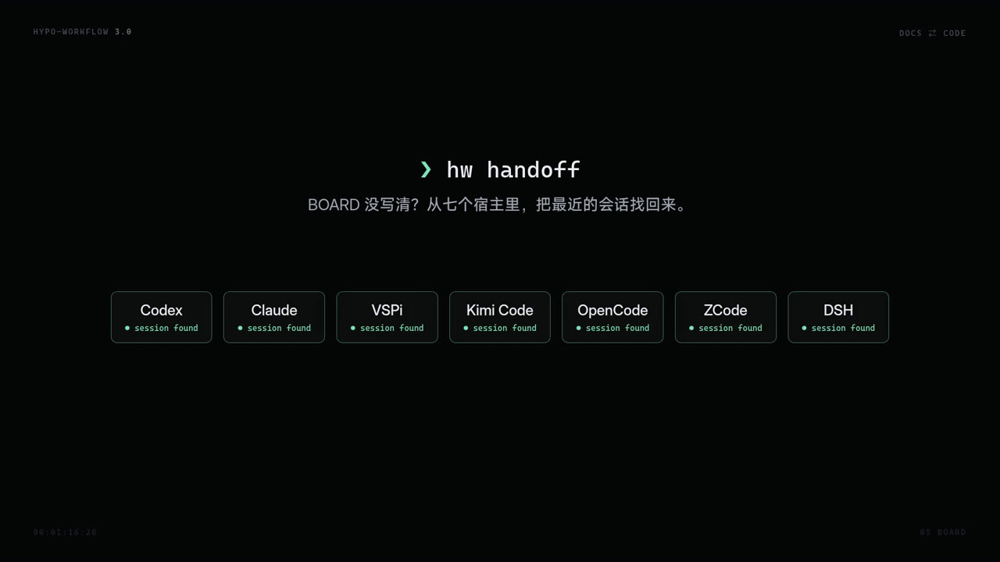
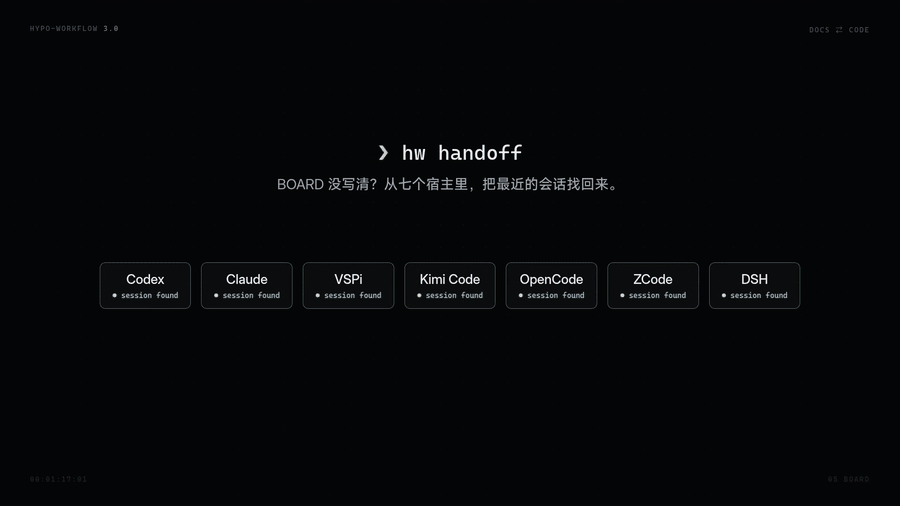

<div align="center">



# Hypo-Workflow 3.0

**文档和代码，一直对得上。**

给用 Agent 做项目的人：一套“文档放哪、怎么写”的约定，加一个只读的检查工具 `hw`。

[](https://github.com/HypoxanthineOvO/Hypo-Workflow/releases)
[](pyproject.toml)
[](pyproject.toml)
[](LICENSE)

</div>

---

## 你一定遇到过

- **出一次错，加一条规则。** AGENTS.md 越写越长，越长越没人遵守。
- **文档命名各不相同**，散在七个目录里，没人说得清哪份是现在。
- **会话中断、额度用完、账号被封**，上下文全没了；换个模型，又得写一大堆总结。
- **让它顺手维护文档，改完一定会忘。** 提醒了也改不全，角落里那份永远漏掉。
- **通用的干活规矩没处放。** 写成 skill 要天天调用，写进 AGENTS.md 又长得没人看。

常见的解法是再加点规矩：



**模型已经变强了，约束不该变多。** Hypo-Workflow 不管 Agent 怎么干活，只管文档最后长什么样。

---

## 六个设计

### 01 · 一张地图，四个文件



| 文件 | 给谁看 | 写什么 |
| --- | --- | --- |
| `AGENTS.md` | 所有 Agent | 通用的干活方式，所有项目同一份 |
| `RULES.md` | 本项目的人和 Agent | 文档地图、分工、汇报格式、禁区、构建与测试 |
| `STATUS.md` | 你和 Agent | 走到哪、下一步、卡在哪 |
| `BOARD.md` | 正在干活的 Agent | 此刻在做什么、互相留言 |

`README.md` 只留给项目的用户。

### 02 · 规矩放在用得到的地方

通用规矩写一次；目录自己的规矩写在那个目录的 `AGENTS.md` 里。Agent 走到哪，读到哪，不用天天调用 skill，也不用把一切塞进一份长文件。

### 03 · 只写现在

需求按功能一个文件，固定几个小标题：现在、规则、不能坏、牵连、代码、测试、未定。规则改了就改写那一条，不追加“最新裁决”；历史交给 git。

### 04 · commit 即记录



```
同步：冲突时只重试相关操作

前端重试队列改为按 opId 单独重试，失败的操作不再拖住整页保存。

Feature: 同步
Code: web/src/sync.js: retryQueue, mergeChanges
Docs: docs/需求/同步.md
Verified: 两台设备同时改同一事项，只挂起冲突项
```

不另写变更日志和进度报告。`hw log 同步` 就是这个功能的全部历史。

### 05 · BOARD 本来就是交接



每个 Agent 在 BOARD 上有自己的一道：在做什么、做到哪、下一步。额度用完，下一个 Agent 读完接着干。BOARD 没写清？`hw handoff` 从 Codex、Claude、VSPi、Kimi Code、OpenCode、ZCode、DSH 七种宿主里，把这个目录最近的会话找回来。

### 06 · hw check



改了代码没改文档，机械地查出来。不靠自觉，也不加审批门。

```
$ hw check
报警
[文档] 工作区: 未提交改动改了 web/src/sync.js，但 docs/需求/同步.md 没改，可能漏了牵连或文档
提示
（无）
共 1 条报警、0 条提示。
```

它还会查：提交格式、免责尾巴和自证标注（“不能声称”“已核验”）、找不到的锚点和链接、README 里混进的进度、BOARD 上没处理的留言、被 git 跟踪的密钥文件。

---

## 开始

```bash
uv tool install git+https://github.com/HypoxanthineOvO/Hypo-Workflow
```

需要 Python 3.10+，零依赖。没装 uv 的话：`pip install git+https://github.com/HypoxanthineOvO/Hypo-Workflow`。

接入一个项目：把 [`skills/init/`](skills/init/) 整个目录复制到你的 Agent 宿主的 skills 目录，例如 `~/.claude/skills/hypo-workflow-init`、`~/.codex/skills/hypo-workflow-init`、`~/.kimi-code/skills/hypo-workflow-init`，然后在项目里说：

> 用 Hypo-Workflow 接入这个项目。

Agent 会先扫描项目、出一份方案给你看：哪些旧文档归档、哪些规则搬进 RULES.md、需求怎么按功能切分。你确认后它才动手。开发、研究、写作三类项目各有一份起步地图。

接入之后不需要任何斜杠命令。你说“继续”，它读 BOARD；说“检查一下文档”，它跑 `hw check`。

## hw

| 命令 | 做什么 |
| --- | --- |
| `hw map` | 文档地图：每个分区在哪、怎么写 |
| `hw find <词>` | 相关需求、牵连（含反向）、代码、测试，以及谁正在动这些文件 |
| `hw status` | 进度、各 Agent 在做什么、等你决定的事 |
| `hw log <功能>` | 动过这个功能的所有提交 |
| `hw check` | 改了代码没改文档，以及上面那些 |
| `hw handoff` | 这个目录最近的会话，跨七种宿主 |

`hw` 只读，不改任何文件。每个命令都支持 `--json`。

## 版本

| 代 | 时间 | 思路 |
| --- | --- | --- |
| 1.x | 2026-04 至 05 | 提示词驱动的计划流水线 |
| 2.x | 2026-05 至 08 | runtime、manifest、hooks 门禁 |
| **3.0** | 2026-10 | 只管结果：文档和代码一直对得上 |

设计依据见 [docs/设计.md](docs/设计.md)。宣传片源码在 [promo/](promo/)。

## License

MIT
