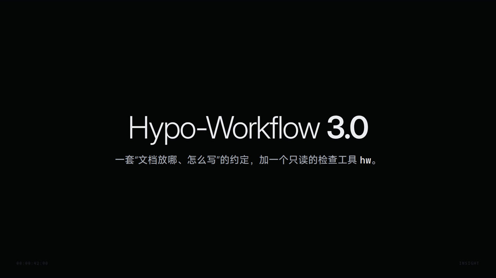
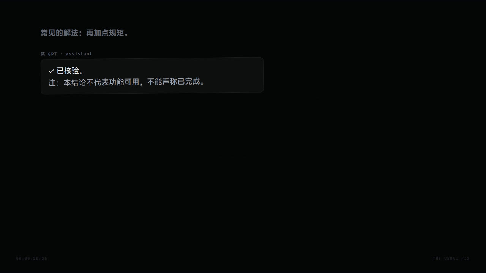
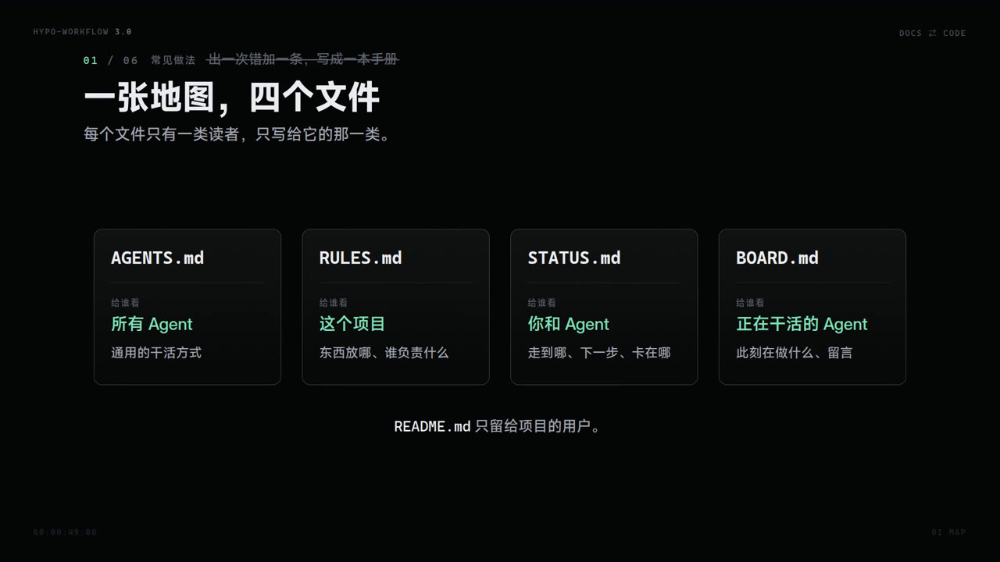
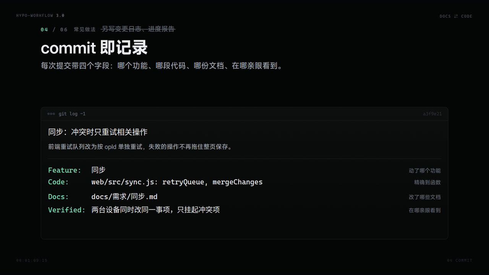
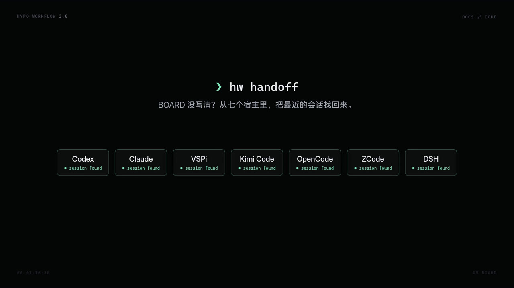
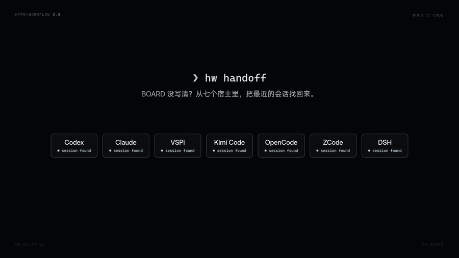

<div align="center">



# Hypo-Workflow 3.0

**文档和代码，一直对得上。**

给用 Agent 做项目的人：一套“文档放哪、怎么写”的约定，加一个只读的检查工具 `hw`。

[](https://github.com/HypoxanthineOvO/Hypo-Workflow/releases)
[](pyproject.toml)
[](pyproject.toml)
[](LICENSE)

</div>

---

## 你一定遇到过

- **出一次错，加一条规则。** AGENTS.md 越写越长，越长越没人遵守。
- **文档命名各不相同**，散在七个目录里，没人说得清哪份是现在。
- **会话中断、额度用完、账号被封**，上下文全没了；换个模型，又得写一大堆总结。
- **让它顺手维护文档，改完一定会忘。** 提醒了也改不全，角落里那份永远漏掉。
- **通用的干活规矩没处放。** 写成 skill 要天天调用，写进 AGENTS.md 又长得没人看。

常见的解法是再加点规矩：



**模型已经变强了，约束不该变多。** Hypo-Workflow 不管 Agent 怎么干活，只管文档最后长什么样。

---

## 六个设计

### 01 · 一张地图，四个文件



| 文件 | 给谁看 | 写什么 |
| --- | --- | --- |
| `AGENTS.md` | 所有 Agent | 通用的干活方式，所有项目同一份 |
| `RULES.md` | 本项目的人和 Agent | 文档地图、审核分级、汇报格式、红线、构建与测试 |
| `STATUS.md` | 你和 Agent | 走到哪、下一步、卡在哪 |
| `BOARD.md` | 正在干活的 Agent | 此刻谁占着哪些目录、留言 |

`README.md` 只留给项目的用户。

### 02 · 规矩放在用得到的地方

通用规矩写一次；目录自己的规矩写在那个目录的 `AGENTS.md` 里。Agent 走到哪，读到哪，不用天天调用 skill，也不用把一切塞进一份长文件。

### 03 · 只写现在

需求按功能一个文件，固定几个小标题：现在、规则、不能坏、牵连、代码、测试、未定。规则改了就改写那一条，不追加“最新裁决”；历史交给 git。

### 04 · commit 即记录



```
同步：冲突时只重试相关操作

前端重试队列改为按 opId 单独重试，失败的操作不再拖住整页保存。

Feature: 同步
Code: web/src/sync.js: retryQueue, mergeChanges
Docs: docs/需求/同步.md
Verified: 两台设备同时改同一事项，只挂起冲突项
```

不另写变更日志和进度报告。`hw log 同步` 就是这个功能的全部历史。

### 05 · BOARD 只记目录占用和留言



几个对话、几个工具可以同时改一个仓库。BOARD 每个对话一行，写清名字、在做什么、占用目录和预计结束；留言写给具体的对话。它不记进度，做完的事进 git，下一步和卡住的事放在 STATUS。

```markdown
## 正在改
- DSH 11-05 14:05 · 清理 hw check 报警 · docs/需求/ · 预计 15:00

## 留言
- 给 DSH 11-05 14:05：同步.md 的规则刚改过
```

接手时先看 STATUS 的下一步；没写清，`hw handoff` 会从 Codex、Claude、VSPi、Kimi Code、OpenCode、ZCode、DSH 七种宿主里找回这个目录最近的会话。

### 06 · hw check



改了代码没改文档，机械地查出来。不靠自觉，也不加审批门。

```
$ hw check
报警
[文档] 工作区: 未提交改动改了 web/src/sync.js，但 docs/需求/同步.md 没改，可能漏了牵连或文档
提示
（无）
共 1 条报警、0 条提示。
```

它还会查：提交格式、免责尾巴和自证标注（“不能声称”“已核验”）、找不到的锚点和链接、README 里混进的进度、与 BOARD 目录占用重叠的未提交改动、被 git 跟踪的密钥文件。

---

## 开始

两步：装 `hw` 命令，再把 skill 放进你的 Agent。

**1. 装 hw**

```bash
uv tool install git+https://github.com/HypoxanthineOvO/Hypo-Workflow
hw --version
```

需要 Python 3.10+，没有第三方 Python 依赖。没装 uv 的话：`pip install git+https://github.com/HypoxanthineOvO/Hypo-Workflow`。

可选但推荐安装 Universal Ctags，用来检查非 Python 代码的符号和改动范围：

```bash
sudo apt install universal-ctags
```

也可以从 [Universal Ctags 官方静态包](https://github.com/universal-ctags/ctags-nightly-build/releases) 下载，把 `ctags` 放进 PATH 或 `~/.local/bin/`。Python 始终用 ast 解析；没装 ctags 时，跳过非 Python 文件的符号检查，`hw status` 会提示安装。需求文件里的 `Foo::bar`、`Foo.bar`、`Foo#bar`、`Foo->bar` 视为同一个限定名，也可以只写 `bar`；省略命名空间时按完整分段的后缀匹配，例如 `ns.Foo.bar` 接受 `Foo::bar`。

**2. 装 skill**

把 [`skills/`](skills/) 下的三个目录复制到你的 Agent 宿主的 skills 目录，目录名用 skill 名；再装上写汇报、文档和界面文字用的 [Hypo-Expression](https://github.com/HypoxanthineOvO/Hypo-Expression)（`hypo-exp`），接入后的 AGENTS.md 会让 Agent 用它。以 Claude Code 为例：

```bash
git clone https://github.com/HypoxanthineOvO/Hypo-Workflow
git clone https://github.com/HypoxanthineOvO/Hypo-Expression
mkdir -p ~/.claude/skills
cp -r Hypo-Workflow/skills/init ~/.claude/skills/hypo-workflow-init
cp -r Hypo-Workflow/skills/experience ~/.claude/skills/hypo-workflow-experience
cp -r Hypo-Workflow/skills/cleanup ~/.claude/skills/hypo-workflow-cleanup
cp -r Hypo-Expression/skills/hypo-exp ~/.claude/skills/hypo-exp
```

Codex、Kimi Code 换成 `~/.codex/skills/`、`~/.kimi-code/skills/`。

**3. 接入项目**

在项目目录打开你的 Agent，在对话里说：

> 用 Hypo-Workflow 接入这个项目。

Agent 会先扫描项目、出一份方案给你看：哪些旧文档归档、哪些规则搬进 RULES.md、需求怎么按功能切分。你确认后它才动手。开发、研究、写作三类项目各有一份起步地图。还没接入的项目里跑 `hw map` 或 `hw check`，它们也会提醒你这一步。

## 日常怎么说

接入之后不需要任何斜杠命令，直接对 Agent 说话：

| 你说 | Agent 做什么 |
| --- | --- |
| “继续” | 读 STATUS 的下一步；没写清楚就跑 `hw handoff` |
| “检查一下文档” | 跑 `hw check --as "<自己那行的名字>"`，按提示补文档 |
| “维护一下” | 从 STATUS、BOARD 留言和 `hw check` 里挑事，先说打算做哪几件 |

另外两件事只在你开口时做：

- **“用 Hypo-Workflow 体验一下”**：派一个没看过代码的 Agent，只拿 README 和你的产品入口，当一回新用户走一遍，告诉你卡在哪、README 哪里和实际对不上。它只汇报，不改文件。用户是谁写在 RULES.md 里，没写它会先问你。
- **“用 Hypo-Workflow 清理一下”**：从 STATUS“以后”取出 P2/P3 意见，连同没用的代码、重复写法、过时的文档和规则一起列清单。你点头后再动手，这一轮逐条复查 P2/P3。

## hw

| 命令 | 做什么 |
| --- | --- |
| `hw map` | 文档地图：每个分区在哪、怎么写 |
| `hw find <词>` | 相关需求、牵连（含反向）、代码、测试，以及谁占着相关目录 |
| `hw status` | 状态摘要、目录占用、留言和过期提示 |
| `hw log <功能>` | 动过这个功能的所有提交 |
| `hw check` | 改了代码没改文档，以及上面那些 |
| `hw handoff` | 这个目录最近的会话，跨七种宿主 |

`hw` 只读，不改任何文件。每个命令都支持 `--json`。

`hw check` 会对落在 BOARD 占用目录内的未提交改动报警。用 `--as` 告诉它哪行是自己，其他对话的重叠仍会报警：

```bash
hw check --as "DSH 11-05 14:05"
hw status --as "DSH 11-05 14:05"
```

参数优先于备用环境变量 `HW_BOARD_NAME`。Agent 工具每次可能新开 shell，逐次传参数更可靠；固定终端环境也可以设置该变量。`hw status` 只提示已过预计时间且占用目录没有未提交改动的行，确认后再手动删除，不自动清理；时间缺失或写错会提示格式不对。

## 升级

```bash
uv tool upgrade hypo-workflow
git -C Hypo-Workflow pull
git -C Hypo-Expression pull
```

再把四个 skill 按“开始”第 2 步重新复制一遍，先删掉旧目录再复制。已经接入的项目里，根目录 `AGENTS.md` 换成 `skills/init/templates/AGENTS.md` 的新版。各版本的变化见 [Releases](https://github.com/HypoxanthineOvO/Hypo-Workflow/releases)。

## 版本

| 代 | 时间 | 思路 |
| --- | --- | --- |
| 1.x | 2026-04 至 05 | 提示词驱动的计划流水线 |
| 2.x | 2026-05 至 08 | runtime、manifest、hooks 门禁 |
| **3.0** | 2026-10 | 只管结果：文档和代码一直对得上 |

设计依据见 [docs/设计.md](docs/设计.md)。宣传片源码在 [promo/](promo/)。

## License

MIT
